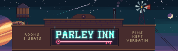

# Design system

ParleyInn's look comes from one picture: the inn at 480 by 330 pixels in
48 colours, drawn in code one pixel at a time. The mark, the palette, the
type and the cast are cut from it, and the GitHub page is built around it.
The page shows the [inn, numbered](https://jeduden.github.io/parleyinn/#inn),
and the [design system](https://jeduden.github.io/parleyinn/design/) with
every part of the kit at its true size.



## The picture

The domain model reads like the inventory of a frontier inn, so the
picture draws it as written. Each of 28 concepts has its place in it,
numbered on the GitHub page, and the page's key gives each one's
definition from the [domain model](domain-model/index.md). A loop of 24
frames moves the neon, the lamps and the smoke.

The inn is the picture, never the vocabulary. Copy, code and the UI name
the domain model's concepts; the frontier only lends each one a place.
A hook is a hook, drawn on a hitching rail.

## The mark

The sign is the mark: PARLEY INN in cyan neon over one long pink key.
Peers are enrolled by key and a principal trusts another principal by
key, so the key is the one symbol that holds everywhere in the model.

- `sign.png` is the sign as it hangs on the inn, 142 by 40.
- `mark-stacked.png` sets PARLEY over INN, and `mark-flat.png` is the
  mark in one colour, for a light ground or a print.
- `icon.png` is the key in a square, 16 by 16; `icon-32.png` and larger
  sizes are whole-number enlargements of it.
- `banner.png` is the inn's front for the top of a README, and
  `banner-2x.png` the same at twice the size.

In text the name is always ParleyInn, one word, as
[ADR-2610221545](adr/ADR-2610221545-product-name-parleyinn.md) decides.
Only the sign's lettering sets PARLEY and INN apart. The tagline is
"Pins kept verbatim."

## Colours

The picture uses 48 colours in seven ramps, and nothing is drawn outside
them. `tokens.json` lists every one by its code, and `palette.png` loads
them into a pixel editor. Eight carry names:

| Name       | Code | Hex       | Where it shows           |
| ---------- | ---- | --------- | ------------------------ |
| Night      | t0   | `#0B1A29` | the ground               |
| Bone       | p2   | `#EAD9B5` | text                     |
| Dusk coral | d4   | `#CC6E57` | the sky over the mesa    |
| Mesa plum  | d1   | `#5A2E48` | the mesa and the shade   |
| Teal       | t4   | `#2F8C8A` | the waistcoats and glass |
| Amber      | am   | `#FFC857` | focus, code, the tagline |
| Neon cyan  | cy   | `#63F3E4` | the selected place       |
| Neon pink  | pk   | `#FF5C8A` | links and numbers        |

Four colours carry a meaning:

- **Neon cyan** is the house's own light: the name on the sign and the
  beams of the pen. The forge is next door, so its horseshoe is iron.
- **Neon pink** is the working light: the key under the name, power
  cells, the ledgers' bookmarks and boundary plates.
- **Amber** is lamplight and the proprietor's business: the Needs you
  sign and the rail its tickets hang on.
- **Red** marks what must not be missed: UNTRUSTED, QUARANTINE, the seals
  and the band on every envelope.

The pages use the same colours: night for the ground, bone for text,
steel for quiet text, and the sign's cyan, pink and amber for accents.
They have one look, dark, and no light theme.

## Type

| Face         | Use                         | Sizes        |
| ------------ | --------------------------- | ------------ |
| Jersey 15    | headings                    | 27 and 54 px |
| Tiny5        | names, numbers and captions | 16 px        |
| Chakra Petch | everything read at length   | 15 to 17 px  |

Jersey 15 draws on a 15-pixel cell and Tiny5 on a 5-pixel one, so both
stay crisp only at whole multiples of it. The pages serve all three from
`docs/design/fonts`, each beside its license. The lettering inside the
picture is set from pixel fonts on their own grid, Micro 5, Silkscreen,
Tiny5 and Jersey 10, whose bitmaps `art/glyphs.json` holds.

## The cast

Hands are steel robots in poncho and hat, each with a power cell on its
back: the agents, whose run is one charge. The house's own staff are
brass, like the compositor who sets the restore block. The proprietor,
the principal, keeps the house: a person or a service account. Figures
from outside the house are dark iron: the outfit's horses, which pull
the harness's wagon; the driver of the stage, a peer that brings sealed
strongboxes; and the smith next door.

## Rules

For pixel art:

1. Show it at whole-number scales with smoothing off
   (`image-rendering: pixelated`), never at one and a half times.
2. Draw only in the 48 colours. Light is a step along a ramp, never a new
   colour.
3. Outline figures and things in ink, one pixel wide.
4. Neon cyan and pink are lights: they glow onto what is near and take no
   light themselves.

For the pages:

1. Edges are square and two pixels wide, with no radius and no blur. The
   one shadow is ink, offset by two pixels.
2. Every file a page loads is a file under `docs/`, and each page's
   content security policy allows nothing else.
3. The loop stops off screen, in a hidden tab and under reduced motion.

## Files

| Path                      | What it is                         | Written by   |
| ------------------------- | ---------------------------------- | ------------ |
| `docs/index.html`         | the GitHub page                    | the build    |
| `docs/design/index.html`  | the design system's page           | the build    |
| `docs/design/tokens.json` | colours, ramps, type and shape     | the build    |
| `docs/design/tokens.css`  | the same as CSS, with the fonts    | the build    |
| `docs/design/assets/`     | every image                        | the build    |
| `docs/design/page.css`    | the pages' style                   | hand         |
| `docs/design/inn.js`      | the explorer of the numbered inn   | hand         |
| `docs/design/art/`        | the source that draws the picture  | hand         |
| `docs/design/fonts/`      | the three faces and their licenses | Google Fonts |
| `docs/.nojekyll`          | has GitHub Pages serve files as-is | hand         |

The fonts and the glyph bitmaps are under the SIL Open Font License 1.1,
whose text sits beside them; the rest is under the repository's license.

## Changing it

The art source runs on Node.js 20 or later and needs no package. Change the
source, rebuild, and check that the files match it:

```sh
node docs/design/art/build.js            # writes pages, design tokens, images
node docs/design/art/build.js --check    # fails naming each file that differs
node docs/design/art/scene.js 0 160 64 142 40 4   # one detail, enlarged
```

`scene.js` draws the sky, the street and the inn's shell, `interior.js`
the inn's interior and the figures in it, and `yard.js` everything
outside.
`marks.js` places each number and its close-up, and `concepts.js` holds
the key's text. The GitHub page repeats the README's opening, its Vision
and Status, and the headline of each invariant; the build reads them from
`README.md` and `docs/srs/invariants.md`, so rebuild after changing
either.

## Publishing

GitHub Pages serves `docs/` from `main`: in the repository's settings,
Pages deploys from the branch `main` and the folder `/docs`. The review
reads the pages' HTML, CSS and JavaScript through the `lang-web`
specialist, and treats images and fonts as files in no language.
